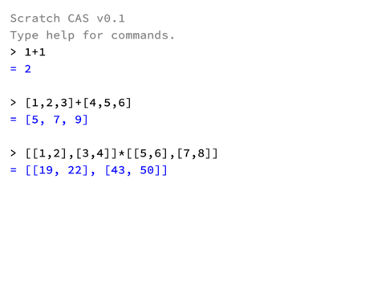

# **sym Scratch**

用 GoboScript 编写、编译到原版 Scratch 3.0 的符号计算。无扩展依赖，可在 Scratch / TurboWarp 中运行。

支持有理数、任意精度整数、BigFloat 科学计数法、多项式、根式、三角、微~~积~~分、极限、向量/矩阵/嵌套列表和变量定义。

**欢迎反馈 bug。**

***

**示例**

```text
simplify(2*x + 3*x - x)
> 4*x

diff(x^x, x)
> x^x + ln(x)*x^x

sqrt(8/9)
> 2/3*sqrt(2)

limit(sqrt(1+x^2)/x, x, oo)
> 1

series(1/(e^(-x)+1), x=oo, 5)
> -e^(-x) - e^(-3*x) - e^(-5*x) + e^(-2*x) + e^(-4*x) + 1

1+1/x-(x+1)/x
> 0

1/x+1/y
> (x + y)/(x*y)

limit(1/x, x, infinity)
> 0

approx(2^(2^100))
> 1e381600854690000000000000000000
```

对每个输入先解析成节点树，再做化简、规则匹配和结构重写；结果最后送入终端。

分式相加会自动通分，并在分子中做多项式合并：

```text
1+1/x              -> (x + 1)/x
1/x+1/y            -> (x + y)/(x*y)
x/y+z/y            -> (x + z)/y
1+1/x-(x+1)/x      -> 0
```

**算法**

- 有理数：约分 + 安全整数运算
- 高精度整数：十进制压位、平方-乘幂
- 多项式 GCD：一元精确除法、二元 modular GCD、n 元 Kronecker/网格插值
- 幂与根式：同底合并、指数律、`abs`/`unitV` 向量处理
- 极限：有限点洛必达/级数；无穷远用 Gruntz 风格 leading-term 比较
- BigFloat：尾数 + 十进制指数两个 double；超出 double 的幂回退到 `log10` 路径
***

**语法**

函数式命令：

```text
simplify(expr)          expand(expr)
diff(expr[, var])       subst(expr, var=expr)
eval(expr, var=value)   approx(expr)
gcd(a, b)               lcm(a, b)
series(expr, x=a, n)    limit(expr, x, a)    # x=oo / infinity 支持渐进展开
```

变量定义：

```text
a=1
b=x^2+1
a+b
> x^2 + 2
```

容器：

```text
[1,2,3]                        向量
[[1,2],[3,4]]                  矩阵
{1, {2, 3}, [4, 5]}            普通列表，可任意嵌套

[1,2,3] + [4,5,6]              -> [5, 7, 9]
[1,2,3] * [4,5,6]              -> 32
dot([1,2,3],[4,5,6])           -> 32
cross([1,2,3],[4,5,6])         -> [-3, 6, -3]
transpose([[1,2],[3,4]])       -> [[1, 3], [2, 4]]
det([[1,2],[3,4]])             -> -2
abs([3,4])                     -> 5
length([1,2,3])                -> 3
unitV([3,4])                   -> [3/5, 4/5]
```

索引与生成：

```text
{1,2,3}[1]                     -> 1
[[1,2],[3,4]][2][1]            -> 3
makelist(x+1, x, 0, 3)         -> {1, 2, 3, 4}
```

容器的一元标量函数会逐元素映射：

```text
sqrt([1,4,9])                  -> [1, 2, 3]
sin([0,pi/2])                  -> [0, 1]
approx([sqrt(2),pi])           -> [1.4142135624, 3.1415926536]
```

**按钮/快捷键**

`c` 清屏，`h` 显示帮助。终端文本可拖动滚动。

**鲁棒性**

```text
1+
> Error: Missing operator number @ func 'tokenizer'

[1,2,3][0]
> Error: Index out of range @ func 'index'
```

***

**构建**

需要 GoboScript 编译器：

```bash
# 在仓库根目录
GOBOSCRIPT=/path/to/goboscript ./tests/build.sh
```

产物是 `cas.sb3`；仓库另附可运行的 `cas-fixed.sb3`。

**限制**

- `det` 目前支持 1×1 / 2×2 / 3×3
- 完整 Gruntz mrv（exp/log 混合极限）尚未实现
- 容器暂不支持所有多元函数；当前重点是映射、线性代数基础与嵌套列表

**借物表**

- [GoboScript](https://github.com/aspizu/goboscript)
- Source Code Pro，Adobe，SIL Open Font License 1.1
- TurboWarp / Scratch 3.0 runtime

**快照**


