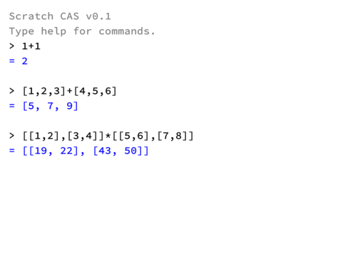

# Terminal Preview 生成说明

## 结论

`terminal-preview.png` **不是 Scratch 舞台截图**，而是：

```text
headless scratch-vm 运行真实项目
        ↓
拦截 printer 的 pen_stamp，记录字形、位置和颜色
        ↓
按 480×360 的 Scratch 舞台坐标重绘
        ↓
PIL / Source Code Pro 生成最终 PNG
```

这样做的原因是：headless 环境没有浏览器 WebGL 舞台渲染器，直接截图不稳定；通过记录真实的 pen stamp 序列再重绘，可以得到可复现、文字清晰的预览图。

---

## 1. 预览内容

当前预览使用三条命令：

```text
1+1
[1,2,3]+[4,5,6]
[[1,2],[3,4]]*[[5,6],[7,8]]
```

对应输出：

```text
2
[5, 7, 9]
[[19, 22], [43, 50]]
```

加上终端头部：

```text
Scratch CAS v0.1
Type help for commands.
```

---

## 2. 在 headless VM 中采集 stamp

使用 `scratch-vm` 加载 `.sb3`，并把 `pen_stamp` 替换成记录器。printer 角色每次进入 `print_text` 时会：

1. 切换 Source Code Pro 字形 costume
2. 设置位置
3. `stamp`

采集脚本的核心部分：

```js
const stamps = [];

rt._primitives.pen_stamp = () => {
  const printer = rt.targets.find(t => t.getName() === 'printer');
  stamps.push({
    x: printer.x,
    y: printer.y,
    name: printer.getCostumes()[printer.currentCostume].name,
    color: printer.effects.color,
    brightness: printer.effects.brightness,
    ghost: printer.effects.ghost
  });
};

rt._primitives.pen_clear = () => {};
```

同时通过 `ask` / `ANSWER` 事件依次输入命令。

采集时还要读取 Stage 的 `term_lines` 和 `term_styles`，它们保存了换行后的终端文本和样式：

```js
const stage = rt.targets.find(t => t.getName() === 'Stage');
const lines = Object.values(stage.variables)
  .find(v => v.type === 'list' && v.name === 'term_lines');
const styles = Object.values(stage.variables)
  .find(v => v.type === 'list' && v.name === 'term_styles');
```

采集结果是一个 JSON，包含每个 stamp 的：

```json
{
  "x": -223.5,
  "y": 157.8,
  "name": "S",
  "color": 0,
  "brightness": -100,
  "ghost": 50
}
```

以及终端文本行和样式编号。

---

## 3. 坐标与字体

Scratch 舞台是 `480 × 360`，坐标原点在中心：

```text
屏幕 x = 240 + stage x
屏幕 y = 180 - stage y
```

printer 的 `print_text` 使用：

```text
字号：45
字符步进：9px（45 / 5）
行高：21px
终端列数：51
```

字体为 **Source Code Pro**。预览不是用字形 SVG 重新拼一遍，而是用同字体的 TTF 直接绘制，因此边缘抗锯齿更干净。

推荐字体路径：

```text
/root/projects/prime/primetcc/rt/tools/source_code_pro/SourceCodePro.ttf
```

在实际仓库用户环境中可以替换为系统安装的 Source Code Pro。

---

## 4. 颜色映射

printer 的 `set_style` 对应四种颜色：

| style | 含义 | 效果 |
|---|---|---|
| 0 | 帮助/提示/灰色 | brightness -100，ghost 50 |
| 1 | 输入命令 | 黑色 |
| 2 | 计算结果 | Scratch color effect 133.33，蓝色 |
| 3 | 错误 | 红色 |

预览图中的：

```text
Scratch CAS v0.1
Type help for commands.
```

是灰色；`> ...` 是黑色；`= ...` 是蓝色。

---

## 5. 重绘流程

一个简化的 PIL 重绘流程如下：

```python
from PIL import Image, ImageDraw, ImageFont

W, H = 480, 360
img = Image.new("RGB", (W, H), "white")
draw = ImageDraw.Draw(img)

font = ImageFont.truetype(
    "/path/to/SourceCodePro.ttf",
    18  # 预览字号，不是 Scratch 内部的 45
)

def stage_to_px(x, y):
    return (W / 2 + x, H / 2 - y)

for stamp in stamps:
    x, y = stage_to_px(stamp["x"], stamp["y"])
    color = style_color(stamp)
    draw.text((x, y), stamp["name"], font=font, fill=color, anchor="ls")

img.save("terminal-preview.png")
```

实际生成时使用 stamp 的基线位置和 Source Code Pro 的实际字符步进；预览字号按 480×360 的显示效果选择，而不是直接使用 Scratch 舞台里的 45px。

也可以不逐个回放 stamp，而是直接按 `term_lines` 重绘：

```text
第一行 y = 16
后续每行 y += 21
每行最多 51 字符
```

这种方式的排版更稳定，但不会保留 printer 内部逐字 stamp 的细节。

---

## 6. 为什么最终图看起来像“截图”

因为重绘使用了：

- 真实运行时产出的终端文本
- 真实的 stamp 坐标
- Source Code Pro 字体
- 与 printer 相同的灰/黑/蓝配色
- Scratch 舞台的 4:3 比例和白色背景

所以视觉上接近 Scratch 舞台，但它是一个**确定性重绘产物**，不是浏览器截图。

---

## 7. 复现步骤

```text
1. 构建 cas.sb3
2. 用 scratch-vm 加载项目
3. 替换 pen_stamp / pen_clear
4. 依次回答：
     1+1
     [1,2,3]+[4,5,6]
     [[1,2],[3,4]]*[[5,6],[7,8]]
5. 保存 stamps + term_lines + term_styles
6. 用 PIL + Source Code Pro 按 480×360 重绘
7. 输出 terminal-preview.png
```

当前图片：



---

## 8. 注意事项

- 预览文本必须使用 ASCII 或已包含在字形表中的字符；终端字形表不包含中文。
- Scratch 的空白输入会触发帮助内容，采集脚本应避免把帮助行混入命令结果。
- 重新采集时，终端行数、字体版本和字号变化都会改变排版，预览图需要重新生成。
- 预览图是文档资产，不参与 `.sb3` 运行。
